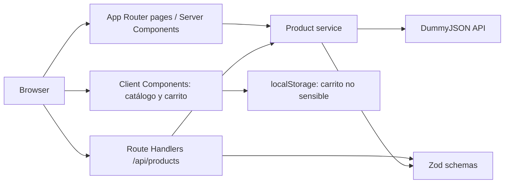

# Software Design Document — TechNova Store

**Versión:** 0.2  
**Fecha:** 2026-11-03  
**Estado:** Implementación y pruebas unitarias/E2E verificadas. Las limitaciones pendientes se enumeran en la sección 18 y en `PROJECT_MEMORY.md`.

## 1. Introducción

TechNova Store es una tienda demostrativa de productos tecnológicos. La interfaz está en español y presenta importes en dólares estadounidenses. El catálogo inicial proviene de DummyJSON. La aplicación no procesa pagos ni solicita información bancaria.

Este documento describe la arquitectura objetivo y separa explícitamente el diseño futuro del estado actual, resumido en `PROJECT_MEMORY.md`.

## 2. Objetivo del sistema

Permitir explorar y buscar productos tecnológicos, consultar sus detalles y mantener un carrito local entre visitas. Proporcionar una API propia para desacoplar la interfaz del proveedor externo y validar los datos que entran al sistema.

## 3. Alcance

### Incluido

- Inicio, catálogo, detalle y carrito.
- Categorías smartphones, laptops, tablets y mobile-accessories.
- Búsqueda, filtro, ordenamiento y paginación del catálogo.
- Persistencia local del carrito y cálculos informativos del subtotal.
- Integración de solo lectura con DummyJSON.
- Diseño responsive y estados de carga, error y ausencia de resultados.

### Fuera de alcance

- Checkout, cobros reales, cuentas, autenticación e información bancaria.
- Inventario o precios autoritativos, órdenes persistidas y administración de productos.
- Garantía de disponibilidad o nivel de servicio del proveedor externo.
- Seguridad absoluta; las medidas implementadas reducen riesgos, pero no sustituyen una auditoría ni un backend comercial.

## 4. Requerimientos funcionales

1. Mostrar una portada con navegación, búsqueda, categorías, productos destacados y beneficios.
2. Listar productos; filtrar por categoría y nombre/marca; ordenar por precio o calificación; mostrar resultados vacíos y errores.
3. Mostrar la imagen, descripción, precio, calificación, disponibilidad, características y cantidad de un producto.
4. Agregar, actualizar y eliminar artículos del carrito; mostrar contador, subtotal y estado vacío.
5. Persistir el carrito en el navegador y validar los datos recuperados.
6. Exponer productos por Route Handlers propios, validando parámetros y respuestas externas.
7. Representar todos los precios usando un formateador centralizado en USD.

## 5. Requerimientos no funcionales

- Next.js 16+, App Router, React, TypeScript estricto, Tailwind CSS, Lucide React y Zod.
- Server Components por defecto y Client Components acotados a interacciones.
- Responsive desde móvil, sin desbordamiento horizontal.
- Imágenes optimizadas con `next/image`, texto alternativo y hosts explícitos.
- Errores HTTP controlados, espera de red limitada y validación de entrada/salida.
- Código mantenible, separación de responsabilidades y documentación sincronizada.
- No almacenar información sensible ni tratar datos del cliente como autoridad comercial.

## 6. Casos de uso principales

| Actor | Caso | Resultado |
|---|---|---|
| Visitante | Explorar la portada | Ve categorías y selección de productos |
| Visitante | Buscar/filtrar el catálogo | Ve resultados y puede ordenar el listado |
| Visitante | Consultar un producto | Ve detalles y selecciona una cantidad válida |
| Visitante | Agregar al carrito | El contador y la vista del carrito se actualizan |
| Visitante | Editar carrito | Cambia cantidades o elimina artículos |
| Visitante | Volver al sitio | El carrito no sensible se recupera desde `localStorage` |

## 7. Arquitectura propuesta

La solución utiliza un monolito Next.js con límites internos claros:



Las páginas de servidor cargan los datos necesarios para la renderización inicial. Los componentes no llaman directamente a DummyJSON. El servicio encapsula el proveedor, aplica timeout, parsea la respuesta y limita los productos a las categorías incluidas. Los Route Handlers convierten parámetros HTTP a entradas validadas y traducen errores de servicio a respuestas HTTP.

### Estructura objetivo

```text
src/
  app/
    api/products/route.ts
    api/products/[id]/route.ts
    productos/page.tsx
    productos/[id]/page.tsx
    carrito/page.tsx
    layout.tsx
    page.tsx
    globals.css
  components/
    cart/
    layout/
    products/
    home/
    shared/
  lib/
    validations/
    categories.ts
    format.ts
  services/
    product-service.ts
  types/
    product.ts
```

La estructura se ajustará a la implementación real y no se crearán directorios vacíos.

## 8. Diseño de las cuatro páginas

### `/` — Inicio

Server Component que obtiene una selección de productos y renderiza hero, llamada a explorar, categorías, destacados, ofertas, beneficios y pie de página. Cabecera y pie reutilizables. La imagen decorativa del hero puede provenir de Unsplash y los productos de DummyJSON.

### `/productos` — Catálogo

Server Component carga el catálogo inicial. Un Client Component recibe productos serializables y controla búsqueda, filtro de categoría y ordenamiento sin necesitar una nueva llamada por cada tecla. Incluye contador de resultados, estados vacíos y error. La API propia permite además paginación cuando se use desde otros consumidores.

### `/productos/[id]` — Detalle

Server Component valida el ID positivo y obtiene el artículo por el servicio. Presenta galería, descripción, precio, disponibilidad, características, selector acotado de cantidad y acción de agregar. Un artículo inexistente se presenta como no encontrado.

### `/carrito` — Carrito

Client Component consumidor del proveedor de carrito. Presenta artículos, cantidades (mínimo 1, máximo 99), eliminación, subtotal y estado vacío. Mientras se recupera `localStorage`, muestra un estado de carga. El total mostrado es informativo; no hay operación de compra.

## 9. Componentes e interfaces

Componentes implementados:

- `Header`: navegación, búsqueda y contador del carrito.
- `Footer`: beneficios y enlaces.
- `ProductCard` / `ProductGrid`: presentación de catálogo.
- `ProductCatalog`: búsqueda, filtro y ordenamiento en cliente.
- `CartProvider`: estado y persistencia del carrito.
- `AddToCartButton`: acción interactiva de agregar.

Las vistas de inicio, catálogo, detalle y carrito están conectadas al layout raíz y a los estados compartidos de carga/error/404.

## 10. Modelos de datos

Tipo `Product` (definido en `src/types/product.ts`):

```ts
interface Product {
  id: number;
  title: string;
  description: string;
  category: "smartphones" | "laptops" | "tablets" | "mobile-accessories";
  price: number;
  discountPercentage?: number;
  rating?: number;
  stock: number;
  brand?: string;
  thumbnail: string;
  images: string[];
  warrantyInformation?: string;
  shippingInformation?: string;
  availabilityStatus?: string;
  dimensions?: { width: number; height: number; depth: number };
}
```

`ProductList` incluye `products`, `total`, `skip` y `limit`. `ProductQuery` incluye `q`, `category`, `limit`, `skip`, `sortBy` (`price`, `rating`, `title`) y `order` (`asc`, `desc`). `CartLine` contiene un producto y una cantidad entera entre 1 y 99. Los esquemas Zod de producto, lista y query se ubican en `src/lib/validations/product.ts`.

## 11. Contratos de API

### `GET /api/products`

Query params opcionales:

| Parámetro | Restricción | Predeterminado |
|---|---|---|
| `q` | texto recortado, máximo 100 caracteres | sin búsqueda |
| `category` | una categoría soportada | todas |
| `limit` | entero de 1 a 50 | 12 |
| `skip` | entero de 0 a 10000 | 0 |
| `sortBy` | `price`, `rating` o `title` | orden del proveedor |
| `order` | `asc` o `desc` | `asc` |

Respuesta `200`:

```json
{ "products": [], "total": 0, "skip": 0, "limit": 12 }
```

### `GET /api/products/[id]`

El ID debe ser un entero positivo. Respuesta `200`: objeto `Product`.

### Errores HTTP

Formato previsto: `{ "error": { "code": "INVALID_QUERY", "message": "Parámetros inválidos." } }`. `400` para query/ID inválidos, `404` para producto inexistente, `502` para fallo o respuesta inválida del proveedor, `504` para timeout y `500` para errores internos no esperados. Los mensajes no incluyen trazas ni datos internos.

## 12. Integración con DummyJSON

- Base URL predeterminada: `https://dummyjson.com`; no requiere API key.
- Fuente: `/products?limit=0` para el catálogo inicial y `/products/{id}` para detalles.
- Validar las respuestas con Zod antes de usarlas.
- Filtrar el conjunto inicial a las cuatro categorías tecnológicas; aplicar búsqueda, categoría, ordenamiento y paginación de forma determinista en la capa de servicio.
- Timeout configurado inicialmente en 8 segundos; caché de servidor con revalidación a 300 segundos.
- Traducir errores de red, timeout, HTTP y esquema inválido a errores de servicio explícitos.
- Los componentes visuales no consumen el proveedor externo de forma directa.

## 13. Estado y formato

- El servidor carga y renderiza productos; filtros del catálogo son estado local de cliente.
- El proveedor de carrito contiene artículos, conteo y subtotal derivados, sin duplicar valores calculables.
- Persistencia en `localStorage` únicamente del carrito de demostración; Zod valida lo recuperado.
- JSON malformado y estructuras que no cumplen el esquema se eliminan del almacenamiento y generan un aviso no sensible; si el navegador bloquea el almacenamiento, se informa y se registra el error.
- Una falla de persistencia debe ser visible para el usuario y registrada; si la API externa no está disponible, se muestra un error y no un catálogo inventado.
- USD se centraliza mediante `Intl.NumberFormat` en `src/lib/format.ts`.

## 14. Seguridad (OWASP)

- **Validación y entradas:** Zod en query params, ID, respuesta externa y carrito persistido; límites numéricos para cantidades.
- **XSS:** no renderizar HTML externo ni usar `dangerouslySetInnerHTML`; React escapa texto por defecto.
- **Datos sensibles:** no hay autenticación, pagos o datos financieros; no persistir datos sensibles.
- **Confianza en cliente:** el precio/subtotal local no se usa como prueba de precio ni para cobrar.
- **Errores:** respuestas genéricas en HTTP, sin stack ni configuración interna.
- **Red/imágenes:** timeout a proveedor, `remotePatterns` restrictivo, `next/image`; usar HTTPS.
- **Almacenamiento del carrito:** solo datos no sensibles; validar con Zod antes de usarlos y retirar JSON inválido.
- **Cabeceras:** se configuraron `X-Content-Type-Options`, `X-Frame-Options`, `Referrer-Policy` y `Permissions-Policy`. Una CSP aún no está configurada y debe evaluarse junto con la carga de recursos externos.
- **Limitaciones:** el catálogo es externo y puede cambiar; la persistencia es modificable por el usuario; no existe backend transaccional, autorización ni protección contra abuso más allá de validaciones y límites de consulta. Esto no equivale a certificar seguridad completa.
- `npm audit` no reportó vulnerabilidades conocidas al realizar la auditoría del 2026-11-03; volver a ejecutarlo antes de publicar versiones futuras.

## 15. Principios SOLID

- **S:** componentes presentan UI; servicio accede al catálogo; esquemas validan; Route Handlers manejan HTTP.
- **O:** categorías y ordenamientos se definen en contratos acotados, sin abstraer proveedores no requeridos.
- **L/I:** tipos y funciones tienen contratos concretos; evitar interfaces genéricas innecesarias.
- **D:** consumidores usan el servicio en vez de acoplarse a DummyJSON desde la vista; si se necesita otro proveedor, se sustituye detrás del servicio.

## 16. Estrategia de pruebas

Hay pruebas unitarias con `node:test` + `tsx` y pruebas E2E con Playwright/Chromium (`npm run test:e2e`). E2E inicia Next.js y un proveedor local de fixtures en puertos separados; cada ejecución usa una URL base aislada para no reutilizar datos cacheados de pruebas anteriores.

1. Unitarias: formato USD, validación de query, servicio (categorías, ordenamiento, paginación y errores de payload/red/timeout/HTTP), Route Handlers y operaciones del carrito.
2. E2E: navegación entre inicio/catálogo/detalle/carrito; presencia/carga de hero; búsqueda, filtros y orden; cantidades, subtotal, eliminación y recarga; estado vacío; descarte de JSON inválido; API 400/502 sin filtrar detalles del proveedor; producto inexistente; ausencia de errores de hidratación; menú móvil y desbordamiento horizontal.
3. La fuente externa no se llama en las E2E: el mock local hace los resultados deterministas y permite simular HTTP 503.
4. Calidad ejecutada: `npm test`, `npm run test:e2e`, `npm run lint`, `npx tsc --noEmit`, `npm run build` y `npm audit`. Los recorridos históricos de navegador y la comprobación responsive de 300 px también se hicieron manualmente.

Las E2E actuales se ejecutan en Chromium; Firefox/WebKit y la persistencia en navegadores distintos no se certifican.

## 17. Despliegue

Preparar para Vercel sin publicar ni desplegar sin autorización. No hay secretos requeridos por DummyJSON. `DUMMYJSON_BASE_URL` es opcional; debe configurarse como variable del entorno si se cambia el proveedor. Los scripts `dev` y `build` usan Webpack. Antes de despliegue: instalar desde lockfile, ejecutar `npm test`, `npm run test:e2e`, lint, TypeScript, auditoría de dependencias y build; revisar configuración de imágenes y probar las rutas en preview.

## 18. Estado de implementación

Las cuatro rutas, Route Handlers, estilos responsive y documentación están implementados. Las validaciones técnicas y las pruebas unitarias/E2E se registran en `PROJECT_MEMORY.md`. Limitaciones: no hay checkout, autenticación, órdenes persistidas, pruebas Firefox/WebKit, despliegue ni publicación en GitHub.
